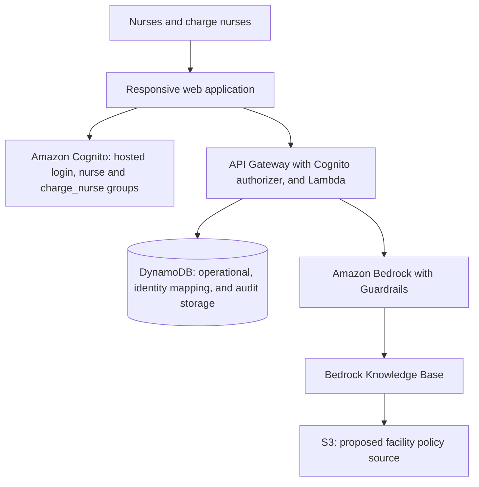

# CareBridge

CareBridge is a crisis coordination application for hospital nurses during an EHR or hospital software outage. It helps nurses share patient updates and helps charge nurses prioritize work, coordinate tasks, and prepare handoffs with support from Amazon Bedrock.

CareBridge assumes electricity and basic internet connectivity remain available. It provides decision support and coordination; it does not diagnose patients, prescribe treatment, or autonomously make clinical decisions.

## Project status

This repository contains a React/Vite frontend, a SAM backend in [`backend/`](backend/README.md), and the [CareBridge requirements](docs/CareBridge_Requirements.md). It is not the operational MVP. The backend has been deployed once to a workshop AWS account, where Cognito sign-in and `GET /me` worked for nurse and charge nurse accounts; the full [deployed smoke test](backend/README.md#deployed-smoke-test) has not been run.

Implemented:

- **Sign-in, sign-out, and role-based access (FR-1–FR-4, NFR-8).** Amazon Cognito hosted login with the authorization code flow and PKCE, administrator-created accounts, and `nurse` / `charge_nurse` groups. The frontend calls `GET /me` to confirm backend authentication and picks screens from the role the API reports: `charge_nurse` gets the charge nurse dashboard and `nurse` gets the nurse view. The API's Cognito authorizer protects every route, and Lambda enforces roles and ownership from verified claims only. Details are in the [backend README](backend/README.md#how-authentication-works).
- **Backend scaffold.** Single-table DynamoDB persistence, persist-first nurse updates, backend-enforced recommendation approval (NFR-24), task ownership rules, and an audit log. Bedrock is a labeled stub.
- **Nurse workspace connected to the API (FR-13–FR-17, FR-38, FR-39).** The nurse view reads `GET /incidents/{id}/workspace`, which returns only the signed-in nurse's patients, assigned tasks, and own updates. Updates, corrections, and task status changes are saved through the API.
- **Charge nurse dashboard connected to the API (FR-30–FR-34, FR-36–FR-40, NFR-24, NFR-25).** It reads `GET /incidents/{id}/dashboard`, so it shows what nurses save. Approving (with edits) or rejecting AI recommendations, running AI review on an update, and reassigning or updating tasks go through the backend, which enforces the charge nurse role and human approval. AI review is still the labeled Bedrock stub.

Main remaining auth gaps: the deployed smoke test has not been run, no in-app administrator role, and a window of up to 30 minutes in which an access token issued before sign-out still works. The full list is in the [backend README](backend/README.md#remaining-gaps). Because there is no administrator role, the administrator console in `src/admin/` is built but not reachable. The broader features and AWS architecture below remain planned unless listed here.

The charge nurse dashboard (`src/ChargeDashboard.jsx`) includes:

- An overview with the incident status and elapsed time, counts of high-priority patients, open, overdue, and unconfirmed tasks, unverified profiles, and urgent updates, the patient table, the latest nurse updates, and the most recent supply request.
- Patient search by name, identifier, room, concern, or nurse; priority and verification filters; nurse filtering; and priority, name, or room sorting.
- Patient details with the continuity profile, freshness, tasks, and every original nurse update for that patient.
- Nurse update details showing the original text, earlier versions if the author corrected it, and the AI processing state. **Run AI review** (or **Retry AI review** after a failure) creates proposed recommendations; a second run on the same update is refused, so retries cannot duplicate them.
- AI review: each recommendation is labeled AI-generated, with its explanation and links to its source updates, and a note to verify before acting. The charge nurse can edit the task description, choose the nurse, priority, and due time, then **Approve and create task**, or **Reject** with an optional reason. Decided recommendations are listed with who decided and when.
- Tasks: status filter (including overdue, unconfirmed, and unable to complete) and sorting by due time, priority, or patient. A task dialog reassigns the task, changes priority, status, or due time, and saves only the fields that changed.
- Care team: each nurse with assignments in the incident, with assigned patients, open tasks, and overdue count.
- A refresh button, a refresh every 30 seconds, and a notice when a refresh fails while the last loaded data stays on screen.
- Handoff preview compiled from stored records, the policy assistant, responsive layouts, keyboard-accessible controls, and native modal dialogs.

Failed actions say what happened: a rejected approval says nothing was applied, a lost connection says the decision could not be confirmed and asks for a refresh before retrying, and an AI failure says the original update is unchanged. The policy assistant is an interactive demo that answers from synthetic policies (see below). Staffing availability, breaks, and coverage gaps are not tracked, so the care team page shows workload only. No clinical action, escalation, message, or incident closure occurs from the frontend.

The nurse view (`src/NurseView.jsx`) reads and writes through the API and shows only the signed-in nurse's data:

- A shift overview of that nurse's patients, assigned tasks, and recent updates, led by an attention banner when the nurse has overdue tasks or high-priority patients.
- The patients assigned to that nurse, with priority and verification-freshness indicators. A patient referenced by one of the nurse's tasks is shown too, labeled as linked to a task.
- A patient detail showing the continuity profile, the nurse's updates for that patient, and the nurse's tasks for the patient.
- The nurse's tasks: acknowledge an unconfirmed task, mark it complete, report a delay, report it as unable to complete, or move it back to in progress. Each change is saved to the API and shows "Saving…", a saved confirmation, or a "Not saved" error on the card.
- A structured-plus-free-text update form with a category and an urgent flag. A save shows the stored update; a failure says plainly that the update was **not** saved and keeps the text in the form. Each saved update shows its AI processing state ("Saved · AI summary not run yet", "Saved · AI processing failed; your original update is kept"), so an AI failure is never confused with a failed save.
- Corrections to the nurse's own updates (text, category, urgent flag). The backend keeps every earlier version in `editHistory`, and the view shows that history.
- A refresh button, a silent refresh every 60 seconds, and a notice when a refresh fails while the last loaded data stays on screen.
- Responsive layouts, keyboard-accessible controls, and a screen-reader status announcement for saves.

Every provisioned nurse gets this view; a nurse with no assignments sees empty states. The incident comes from `VITE_INCIDENT_ID` (default `INC-0042`, the seeded demo incident). If that incident does not exist, the view says so. Synthetic data only; do not connect real patient data.

The administrator console (system overview, user management, synthetic patient-data management, facility policy documents, and incident configuration) is built in `src/admin/` but not routed, because the backend has no administrator role. Its mutating controls are preview-only.

These screens explore FR-7, FR-9–FR-11, FR-13–FR-17, FR-22–FR-24, FR-29–FR-33, FR-37–FR-39, and FR-43 visually; they do not satisfy the complete backend, persistence, audit, or AWS requirements.

The project targets an 18-hour hackathon build using **synthetic patient data only**. It is a demonstration, with no claim of production readiness or regulatory certification.

## Users

| Role | Responsibilities |
| --- | --- |
| Nurse | Submit patient updates, review assigned tasks, and record completion, delays, or inability to complete work. |
| Charge nurse | Activate and close incidents, review risks and staffing, approve or correct AI recommendations, assign tasks, escalate concerns, and prepare final handoffs. |
| System administrator | Configure users, facility policies, and synthetic patient data. Detailed administrator permissions remain to be defined. |

Secure sign-in, sign-out, role-specific views, and enforced access permissions are baseline requirements. Advanced authentication is a stretch feature, not a reason to omit baseline access control.

## MVP priorities

Build these capabilities in the order recommended by the requirements:

1. Nurse update submission.
2. Charge nurse dashboard.
3. Shared patient and task database.
4. Bedrock summarization and prioritization.
5. Human approval workflow.
6. Policy question answering with citations.

Notifications, offline mode, file uploads, advanced authentication, and HealthLake integration are stretch features. Keep these outside the core build unless the MVP is complete.

## Expected workflow

1. A charge nurse activates an incident, such as an EHR outage, medication-system outage, staffing disruption, or hospital communication outage. Users can see its status and duration.
2. Nurses review limited patient continuity profiles, including allergies, critical medications, relevant conditions, care priorities, risk indicators, and assigned nurses. Information that has not been recently verified is flagged.
3. At least two nurses submit structured or natural-language updates. Updates capture condition changes, concerns, medication status, completed or delayed tasks, supply needs, staffing availability, and notes. Each update has a patient, author, timestamp, and optional urgent flag.
4. The application stores each original update before requesting AI processing. Nurses can correct their own updates while preserving an audit history.
5. Bedrock extracts structured information, identifies potential risks and follow-up work, generates handoff summaries, and recommends priorities. AI output is labeled, explains its reasoning, links to supporting updates, and tells users to verify it before acting.
6. The charge nurse reviews, approves, rejects, or modifies recommendations. A recommendation requires human approval before it creates an assignment, escalation, or patient-status change.
7. Nurses update task status; the dashboard promptly reflects changes and flags overdue or unconfirmed work. Nurses can also ask policy questions and receive answers grounded in facility documents with citations.
8. After normal services return, the charge nurse views or exports a final crisis handoff summary and deactivates the incident.

## Functional scope

Requirement identifiers below refer to the source requirements document.

| Area | Planned capabilities | Requirements |
| --- | --- | --- |
| Access | Secure sign-in and sign-out, nurse and charge nurse roles, role-specific functionality. | FR-1–FR-4 |
| Incidents | Activate and deactivate incidents; show crisis type, status, and duration. | FR-5–FR-8 |
| Patient continuity | Limited patient profiles, authorized viewing, verification freshness, and change history. | FR-9–FR-12 |
| Nurse updates | Structured and free-text submission, author/patient/time association, urgent flags, and correction of a nurse's own updates. | FR-13–FR-17 |
| Bedrock processing | Structured extraction, risk and deadline identification, handoff summaries, priority recommendations, supporting sources, AI labeling, and human verification. | FR-18–FR-25 |
| Policy assistant | Emergency procedure questions answered through a Bedrock Knowledge Base, with citations and an explicit indication when reliable information is unavailable. | FR-26–FR-29 |
| Charge nurse dashboard | Patients and risk levels, unresolved and overdue tasks, urgent updates, available nurses, staffing gaps, supply concerns, and unverified information; filtering, sorting, recommendation review, task assignment, and escalation. | FR-30–FR-35 |
| Tasks | Authorized creation; description, patient, priority, assigned nurse, due time, status, creator, and timestamp; completion/delay/unable-to-complete reporting; overdue and unconfirmed indicators. | FR-36–FR-40 |
| Audit and recovery | Record patient changes, updates, recommendations, decisions, assignments, and escalations; preserve original updates; view or export final handoffs. | FR-41–FR-43 |

## Proposed AWS architecture

Cognito, the API Gateway REST API with its Cognito authorizer, Lambda, and DynamoDB are defined in [`backend/template.yaml`](backend/template.yaml) but have not been deployed. Only Amazon Bedrock, a Bedrock Knowledge Base, and Bedrock Guardrails are specified AI components in the requirements; Bedrock, the Knowledge Base, and S3 policy storage are not built yet.



Persist nurse updates before invoking Bedrock. Store AI results separately with references to their source information and review decisions. Persist approved actions through an authorized backend operation; displaying or generating a recommendation must not apply it.

Keep patient profiles, incidents, nurse updates, tasks, AI recommendations, audit records, and policy documents logically separate. Backend authorization must enforce permissions independently of the interface. Facility policies must be updateable without application code changes, and the frontend, database access, and Bedrock integration must be independently testable.

## Safety, security, and reliability

- Use synthetic patient data throughout the hackathon, including fixtures, screenshots, prompts, and demonstrations.
- Encrypt patient data in transit and at rest where supported by AWS services. Keep credentials out of source control, and keep patient information out of logs, error messages, and public URLs.
- Configure Bedrock Guardrails to reduce unsafe responses. Bedrock must not independently diagnose, prescribe treatment, change medication, or reassign patients. Guardrails support, but do not replace, application authorization and human approval.
- Preserve original patient and nurse data. AI output must never overwrite its sources; corrections must retain an audit history.
- Show supporting sources, uncertainty, stale information, and missing policy evidence clearly. Do not present incomplete information as fact.
- If Bedrock or another required AWS service is unavailable, display a clear error. A failed AI request must not discard a saved nurse update.
- Record important actions and their authors and timestamps, including approvals, rejections, task assignments, and escalations.

## Quality targets

These are acceptance targets from the requirements, not measured results.

| Measure | Target |
| --- | --- |
| Standard dashboard page load | Within 3 seconds under normal demo conditions. |
| Nurse update persistence | Immediately after submission; independent of AI success. |
| AI summaries and recommendations | Normally within 10–15 seconds. |
| Dashboard changes | Refresh or update promptly after new information or task changes. |
| Basic nurse update entry | Fewer than 30 seconds. |
| Highest-priority issue identification | Within 10 seconds of opening the charge nurse dashboard. |
| Device support | Desktop, tablet, and mobile browsers. |

Use plain language and clear urgency labels; do not rely on color alone to convey priority. Operational verification freshness thresholds and the exact meaning of prompt dashboard updates still need implementation decisions; the visual prototype uses the documented 60-minute example below.

## Local development

Use Node.js 22.12 or later in the Node 22 line, or a newer supported LTS release, and npm. Sign-in needs a deployed backend stack; see the [backend README](backend/README.md#deploy) to deploy it, create accounts, and provision identity mappings. Then, from the repository root:

```sh
npm install
cp .env.example .env.local   # then fill in from the stack outputs (below)
npm run dev
```

Open **`http://localhost:5173`**, the URL Vite prints. Use `localhost`, not `127.0.0.1`: Cognito's callback and sign-out URLs and the API's CORS origin are registered for `http://localhost:5173`, and the app refuses to start sign-in from a different origin. The dev server binds to loopback only and fails rather than moving to another port. Stop it with Ctrl+C. Without `.env.local`, the app shows a "Sign-in isn't configured" screen listing the missing settings.

```sh
npm test         # Frontend unit tests (config, API client, sign-out)
npm run build    # Create the production frontend in dist/
npm run preview  # Serve that build at http://localhost:5173 (same sign-in URLs)
```

The lockfile is included, so installs can use `npm ci`.

### Populate frontend config from stack outputs

All `VITE_` values are public configuration that ships in the browser bundle. User pool IDs, app client IDs, and domain URLs are safe to expose. Never put passwords, client secrets, AWS access keys, or session tokens in a `VITE_` variable; the app refuses to start if a variable name looks like one. `.env.local` is gitignored.

```sh
STACK=carebridge-dev
out() { aws cloudformation describe-stacks --stack-name "$STACK" \
  --query "Stacks[0].Outputs[?OutputKey=='$1'].OutputValue" --output text; }
cat > .env.local <<EOF
VITE_API_BASE_URL=$(out ApiBaseUrl)
VITE_COGNITO_REGION=$(out Region)
VITE_COGNITO_USER_POOL_ID=$(out UserPoolId)
VITE_COGNITO_APP_CLIENT_ID=$(out UserPoolClientId)
VITE_COGNITO_DOMAIN=$(out CognitoLoginDomain)
VITE_AUTH_REDIRECT_URI=$(out CallbackUrl)
VITE_AUTH_LOGOUT_URI=$(out SignOutUrl)
EOF
```

Restart `npm run dev` after changing `.env.local`.

### Sign-in and session behavior

- **Library.** [`react-oidc-context`](https://github.com/authts/react-oidc-context) 3.3.1 over `oidc-client-ts` 3.5.0 (pinned). The library handles the redirect, PKCE (S256), and `state` validation. The app also sends a random `nonce`, which the library checks against the ID token. The client has no secret.
- **Callback.** Cognito returns to `/auth/callback`. After the code exchange, the app replaces the address with `/`, so the authorization code and state don't stay in the URL or history. Failed or replayed callbacks show "Sign-in didn't complete" without echoing error details.
- **Verification.** After sign-in the app calls `GET /me`. It shows the charge nurse dashboard only when the API reports `charge_nurse`, and the API-backed nurse view for `nurse`. An unmapped account sees "Your account isn't set up yet." The UI choice is convenience; the API enforces every permission.
- **API calls.** `src/api/client.js` sends `Authorization: Bearer <access token>`, never `X-User-Id` / `X-User-Role`, never cookies, and keeps tokens out of URLs, errors, and logs.
- **Token storage.** Access, ID, and refresh tokens, plus in-flight sign-in state (state, nonce, PKCE verifier), are stored in this tab's **sessionStorage** under `oidc.` keys. They survive a page reload, are not shared with other tabs, and are cleared when the tab closes. Any script running on the page could read them, so avoid third-party scripts and add a Content Security Policy when hosting.
- **Expiry.** Access tokens last 30 minutes. About a minute before expiry the library renews silently with the refresh token (12-hour lifetime). If renewal fails, or the API returns 401, the app clears the session and shows "Your session ended."
- **Sign-out.** The app clears protected data held in memory, revokes the refresh token at Cognito (best effort), removes the stored user and all `oidc.` entries, then redirects to Cognito `/logout`, which ends the hosted-login session and returns to `VITE_AUTH_LOGOUT_URI`. An access token issued before sign-out stays valid at the API until it expires; the [backend README](backend/README.md#tokens-and-sign-out) explains how to cut off access immediately.

### Hosting the frontend

Deploy a stack whose `FrontendOrigin`, `CallbackUrl`, and `SignOutUrl` use the hosted HTTPS address ([backend README](backend/README.md#change-callback-and-sign-out-urls-for-hosting)), rebuild with matching `VITE_` values, and serve `dist/`. Configure the host to return `index.html` for `/auth/callback` (an SPA rewrite on Amplify Hosting, or a CloudFront error response for S3).

### Frontend structure and demo behavior

- `src/entry.jsx`: auth provider setup.
- `src/RoleView.jsx`: role routing after sign-in. `charge_nurse` gets the charge nurse dashboard; `nurse` gets the nurse view.
- `src/ChargeDashboard.jsx`: the API-backed charge nurse dashboard. `src/charge/dashboard.js` holds its pure helpers (staff names, filtering, task change detection, decision messages), unit-tested in `tests/charge-dashboard.test.js`.
- `src/ui.jsx`: shared `Badge`, `Avatar`, and `Priority` components.
- `src/NurseView.jsx`: the API-backed nurse workspace. `src/nurse/workspace.js` holds its pure helpers (indicators, sorting, save messages), unit-tested in `tests/nurse-workspace.test.js`.
- `src/auth/`: sign-in configuration and validation (`config.js`), the sign-in, access-check, and error screens (`AuthGate.jsx`), and sign-out helpers (`session.js`).
- `src/api/client.js`: the small API client that attaches the access token, with calls for `/me`, the nurse workspace, saving and correcting updates, and task status.
- `src/PolicyAssistant.jsx`, `src/policies.js`: the policy assistant and its synthetic policy fixtures.
- `src/admin/AdminApp.jsx`, `src/admin/AdminDashboard.jsx`: the administrator console, not routed until the backend has an administrator role.
- `src/data.js`: synthetic patients, nurses, updates, tasks, incident, and authored AI examples, plus the update categories used by the nurse view. Source updates and recommendations are separate records linked by identifiers. The backend seed script and backend tests read these fixtures too.
- `src/styles.css`: light/teal styling and responsive layouts. DM Sans and Manrope load from Google Fonts when reachable, with local sans-serif fallbacks.
- `index.html`: Vite entry point; loads `src/entry.jsx`.
- `vite.config.js`: serves the dev and preview servers on `localhost`.
- `.env.example`: placeholder sign-in and API settings, plus the optional `VITE_INCIDENT_ID`.

Both views read stored timestamps from the API. Incident duration and overdue/freshness calculations use timestamps, refresh every 30 seconds, and do not depend on the viewer's locale. Displayed times use `America/Los_Angeles` (Pacific time). Information is flagged as unverified if it has no verification timestamp or was last verified more than **60 minutes** ago; this is a prototype choice, not a requirement or facility policy.

The seeded demo incident has eight patients and two authored recommendations; recommendations created by **Run AI review** come from the backend's labeled stub, not Bedrock. The policy assistant answers questions by matching keywords against synthetic, in-browser policy fixtures and cites the matched fixture document; unmatched questions produce an explicit no-evidence response. It performs no AI reasoning and no retrieval, and does not use a Bedrock Knowledge Base or any backend. Handoff is a read-only view, not an export or incident closure.

The nurse view uses the same 60-minute freshness threshold, returned by the API in `meta.verificationFreshnessMinutes`, and recalculates overdue and unverified indicators every 30 seconds from the stored timestamps.

### Policy assistant: demo vs. intended design

The current policy assistant is a frontend-only demonstration. A nurse's question is matched by simple keyword lookup against five synthetic policy fixtures in `src/policies.js`, and the matched fixture is shown with a citation to its (fictional) document reference. There is no AI, no semantic understanding, and no network call; questions that do not hit a known keyword return an explicit no-evidence response rather than a guess.

The intended design (FR-27) replaces the local lookup with a backend call to an Amazon Bedrock Knowledge Base built over real facility policy documents (for example, stored in S3). The frontend contract is unchanged — a question in, a cited answer or no-evidence response out — so the integration point is the single `findPolicies` call in `src/PolicyAssistant.jsx`.

Known demo limitations: policy content is editable only by changing `src/policies.js` (code), so it does not yet satisfy the "updateable without application code changes" goal; and matching is keyword-based, so rephrased questions may not match. These are demo constraints, not the intended production behavior.

### Verification

Verified locally on October 23, 2026 (Node 22.16.0, npm 10.9.2), without deploying anything:

| Check | Result |
| --- | --- |
| `npm test` (frontend) | 17 tests pass: config validation, secret-variable guard, origin check, logout URL, Bearer header without identity headers, token-free errors, sign-out order and storage cleanup. |
| `npm run build` | Passes. The bundle contains no `X-User` headers. |
| `npm run dev` | Serves `http://localhost:5173` on loopback; `/auth/callback` returns the app. |
| `cd backend && npm test` | 94 tests pass with mocked authorizer claims. Removing the client-id check or the dashboard role check made the suite fail, confirming the tests detect those regressions. |
| `cfn-lint`, `sam validate --lint` | Pass (run through `uvx`; the SAM CLI is not installed globally). |
| `scripts/check-template-auth.py` | Every non-OPTIONS method requires `CognitoAuthorizer` with `carebridge/access`; OPTIONS is open; gateway errors carry CORS headers; one stage named after `Stage`. |
| Headless Chrome against the dev server | With Cognito endpoints stubbed in the browser and a local `/me` stub: the authorize request uses `code`, S256 PKCE, state, and nonce; the code exchange sends the verifier and no secret; a valid callback loads the dashboard and clears the URL; replayed callbacks and a wrong nonce are rejected; nurse and charge views follow `/me`; 401 and token expiry end the session; sign-out clears storage and redirects to `/logout`; sign-in and nurse screens fit a 390-pixel viewport. |

Not verified: anything against live Cognito or API Gateway (hosted login pages, the real authorizer, CORS on deployed gateway errors, refresh-token renewal and revocation at Cognito). Run the [deployed smoke test](backend/README.md#deployed-smoke-test) after the first deploy. Mocked-claim tests show how Lambda treats verified claims; they are not evidence that the deployed authorizer works, and `sam local` does not run Cognito authorizers either.

After merging `combine-frontend` into this branch (October 23, 2026; Node 25.8.2, npm 11.11.1), `npm test` (17 pass), `npm run build`, and `cd backend && npm test` (94 pass, including the tests that read `src/data.js`) all pass. A temporary headless-Chrome check rendered `RoleView` with mocked `/me` results: `charge_nurse` showed the charge nurse dashboard, a nurse with user id `n1` saw only that nurse's shift data, an unlinked nurse id saw the minimal signed-in screen, and each screen's sign-out control called the sign-out handler. Without `.env.local`, the dev server shows the "Sign-in isn't configured" screen. The real Cognito sign-in and `GET /me` call were not exercised.

After connecting the nurse view to the API (October 24, 2026): `npm test` (29 pass), `npm run build`, `cd backend && npm test` (111 pass with mocked claims), `sam validate`, and `scripts/check-template-auth.py` (the new workspace route requires `CognitoAuthorizer` with `carebridge/access`) all pass. A temporary headless-Chrome harness rendered `NurseView` against a fake API client: the shift, task, patient, and update screens rendered; saving a task status, submitting an update, and correcting an update showed the saved results and correction history; a failed save kept the text and said it was not saved; a failed task save showed "Not saved"; a missing incident showed "No active incident found"; and the page had no horizontal overflow at 500 pixels (headless Chrome's minimum) and 820 pixels. The new backend route has not been deployed or exercised against live AWS.

After connecting the charge nurse dashboard to the API (October 24, 2026): `npm test` (39 pass), `npm run build`, and `cd backend && npm test` (124 pass with mocked claims) pass. A temporary headless-Chrome harness rendered `ChargeDashboard` against a fake API built from the seed items: overview, tasks, care team, and AI review pages rendered; approving, rejecting, running AI review, and reassigning a task showed the saved results; failed approval, failed AI review, and a failed load showed their messages. It found a horizontal overflow at narrow widths caused by an absolutely positioned screen-reader label in the patient table, fixed by making `.table-scroll` a positioning container; after the fix there was no horizontal overflow at 500 and 820 pixels. Not exercised against live AWS.

See [frontend verification notes](docs/Frontend_Verification.md) for the earlier visual prototype checks. Persistence through the UI, retries, AWS integrations, and operational performance targets remain unverified.

Before integrating AWS, select a region and a supported Bedrock model, establish least-privilege service permissions, configure Guardrails, and prepare a Knowledge Base with synthetic or demonstration facility policies. Document actual configuration variable names and setup steps alongside the implementation; do not commit secrets.

## Demo acceptance checklist

- [ ] Simulate an EHR outage with an active incident.
- [ ] Show at least two nurses submitting synthetic patient updates.
- [ ] Show the charge nurse dashboard reflecting patients, urgent concerns, and task status.
- [ ] Show Bedrock generating a summary or prioritization with supporting sources.
- [ ] Show a charge nurse reviewing and approving an AI recommendation before its resulting action occurs.
- [ ] Demonstrate task assignment and a nurse recording task progress or completion.
- [ ] Demonstrate policy question answering with citations and a clear no-evidence response.
- [ ] Demonstrate that a failed AI request preserves the original nurse update.
- [ ] View or export the final crisis handoff and close the incident.
- [ ] Present the AWS architecture and identify where Bedrock is used.

## Contributing

Read [AGENTS.md](AGENTS.md) before making changes. Use the [requirements document](docs/CareBridge_Requirements.md) for detailed acceptance criteria and preserve its FR/NFR identifiers when describing implementation coverage. Update this README as features, architecture decisions, and verified development commands are added.
