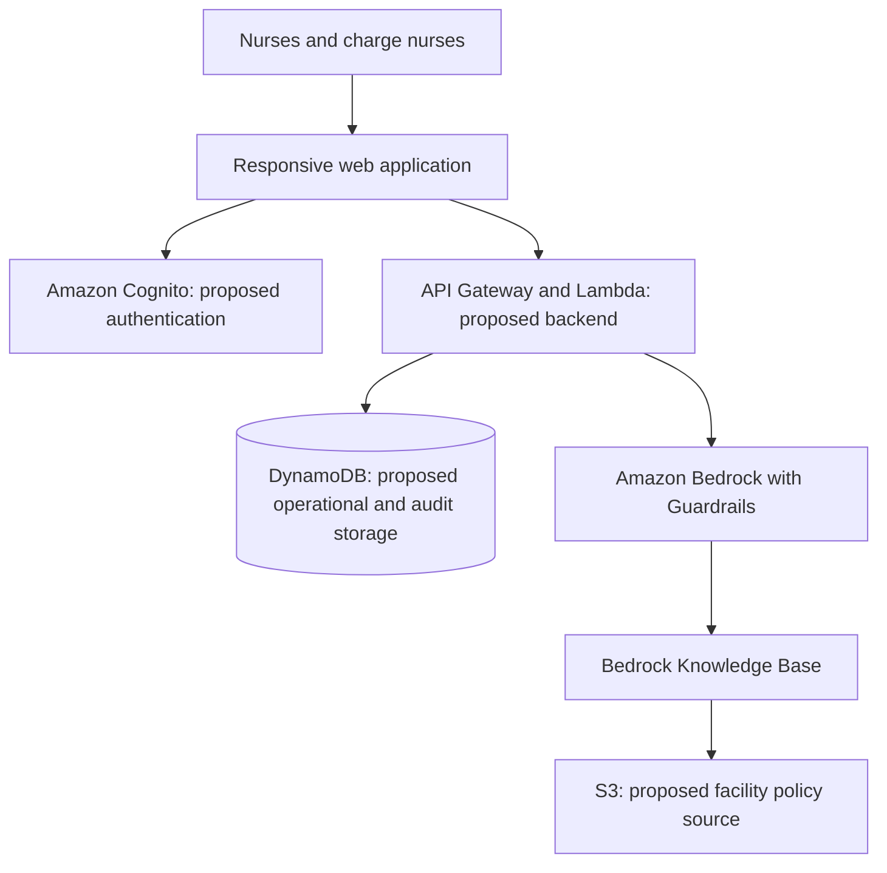

# CareBridge

CareBridge is a crisis coordination application for hospital nurses during an EHR or hospital software outage. It helps nurses share patient updates and helps charge nurses prioritize work, coordinate tasks, and prepare handoffs with support from Amazon Bedrock.

CareBridge assumes electricity and basic internet connectivity remain available. It provides decision support and coordination; it does not diagnose patients, prescribe treatment, or autonomously make clinical decisions.

## Project status

This repository is at the requirements stage. It currently contains project documentation and the [CareBridge requirements](docs/CareBridge_Requirements.md); application code, infrastructure, and automated tests have not yet been added. Features and architecture described below are planned, not implemented.

The project targets an 18-hour hackathon build using **synthetic patient data only**. It is a demonstration, with no claim of production readiness or regulatory certification.

## Users

| Role | Responsibilities |
| --- | --- |
| Nurse | Submit patient updates, review assigned tasks, and record completion, delays, or inability to complete work. |
| Charge nurse | Activate and close incidents, review risks and staffing, approve or correct AI recommendations, assign tasks, escalate concerns, and prepare final handoffs. |
| System administrator | Configure users, facility policies, and synthetic patient data. Detailed administrator permissions remain to be defined. |

Secure sign-in, sign-out, role-specific views, and enforced access permissions are baseline requirements. Advanced authentication is a stretch feature, not a reason to omit baseline access control.

## MVP priorities

Build these capabilities in the order recommended by the requirements:

1. Nurse update submission.
2. Charge nurse dashboard.
3. Shared patient and task database.
4. Bedrock summarization and prioritization.
5. Human approval workflow.
6. Policy question answering with citations.

Notifications, offline mode, file uploads, advanced authentication, and HealthLake integration are stretch features. Keep these outside the core build unless the MVP is complete.

## Expected workflow

1. A charge nurse activates an incident, such as an EHR outage, medication-system outage, staffing disruption, or hospital communication outage. Users can see its status and duration.
2. Nurses review limited patient continuity profiles, including allergies, critical medications, relevant conditions, care priorities, risk indicators, and assigned nurses. Information that has not been recently verified is flagged.
3. At least two nurses submit structured or natural-language updates. Updates capture condition changes, concerns, medication status, completed or delayed tasks, supply needs, staffing availability, and notes. Each update has a patient, author, timestamp, and optional urgent flag.
4. The application stores each original update before requesting AI processing. Nurses can correct their own updates while preserving an audit history.
5. Bedrock extracts structured information, identifies potential risks and follow-up work, generates handoff summaries, and recommends priorities. AI output is labeled, explains its reasoning, links to supporting updates, and tells users to verify it before acting.
6. The charge nurse reviews, approves, rejects, or modifies recommendations. A recommendation requires human approval before it creates an assignment, escalation, or patient-status change.
7. Nurses update task status; the dashboard promptly reflects changes and flags overdue or unconfirmed work. Nurses can also ask policy questions and receive answers grounded in facility documents with citations.
8. After normal services return, the charge nurse views or exports a final crisis handoff summary and deactivates the incident.

## Functional scope

Requirement identifiers below refer to the source requirements document.

| Area | Planned capabilities | Requirements |
| --- | --- | --- |
| Access | Secure sign-in and sign-out, nurse and charge nurse roles, role-specific functionality. | FR-1–FR-4 |
| Incidents | Activate and deactivate incidents; show crisis type, status, and duration. | FR-5–FR-8 |
| Patient continuity | Limited patient profiles, authorized viewing, verification freshness, and change history. | FR-9–FR-12 |
| Nurse updates | Structured and free-text submission, author/patient/time association, urgent flags, and correction of a nurse's own updates. | FR-13–FR-17 |
| Bedrock processing | Structured extraction, risk and deadline identification, handoff summaries, priority recommendations, supporting sources, AI labeling, and human verification. | FR-18–FR-25 |
| Policy assistant | Emergency procedure questions answered through a Bedrock Knowledge Base, with citations and an explicit indication when reliable information is unavailable. | FR-26–FR-29 |
| Charge nurse dashboard | Patients and risk levels, unresolved and overdue tasks, urgent updates, available nurses, staffing gaps, supply concerns, and unverified information; filtering, sorting, recommendation review, task assignment, and escalation. | FR-30–FR-35 |
| Tasks | Authorized creation; description, patient, priority, assigned nurse, due time, status, creator, and timestamp; completion/delay/unable-to-complete reporting; overdue and unconfirmed indicators. | FR-36–FR-40 |
| Audit and recovery | Record patient changes, updates, recommendations, decisions, assignments, and escalations; preserve original updates; view or export final handoffs. | FR-41–FR-43 |

## Proposed AWS architecture

The following is an implementation starting point. Only Amazon Bedrock, a Bedrock Knowledge Base, and Bedrock Guardrails are specified AI components in the requirements; the remaining service choices are proposals to validate during implementation.

Persist nurse updates before invoking Bedrock. Store AI results separately with references to their source information and review decisions. Persist approved actions through an authorized backend operation; displaying or generating a recommendation must not apply it.

Keep patient profiles, incidents, nurse updates, tasks, AI recommendations, audit records, and policy documents logically separate. Backend authorization must enforce permissions independently of the interface. Facility policies must be updateable without application code changes, and the frontend, database access, and Bedrock integration must be independently testable.

## Safety, security, and reliability

- Use synthetic patient data throughout the hackathon, including fixtures, screenshots, prompts, and demonstrations.
- Encrypt patient data in transit and at rest where supported by AWS services. Keep credentials out of source control, and keep patient information out of logs, error messages, and public URLs.
- Configure Bedrock Guardrails to reduce unsafe responses. Bedrock must not independently diagnose, prescribe treatment, change medication, or reassign patients. Guardrails support, but do not replace, application authorization and human approval.
- Preserve original patient and nurse data. AI output must never overwrite its sources; corrections must retain an audit history.
- Show supporting sources, uncertainty, stale information, and missing policy evidence clearly. Do not present incomplete information as fact.
- If Bedrock or another required AWS service is unavailable, display a clear error. A failed AI request must not discard a saved nurse update.
- Record important actions and their authors and timestamps, including approvals, rejections, task assignments, and escalations.

## Quality targets

These are acceptance targets from the requirements, not measured results.

| Measure | Target |
| --- | --- |
| Standard dashboard page load | Within 3 seconds under normal demo conditions. |
| Nurse update persistence | Immediately after submission; independent of AI success. |
| AI summaries and recommendations | Normally within 10–15 seconds. |
| Dashboard changes | Refresh or update promptly after new information or task changes. |
| Basic nurse update entry | Fewer than 30 seconds. |
| Highest-priority issue identification | Within 10 seconds of opening the charge nurse dashboard. |
| Device support | Desktop, tablet, and mobile browsers. |

Use plain language and clear urgency labels; do not rely on color alone to convey priority. Verification freshness thresholds and the exact meaning of prompt dashboard updates still need implementation decisions.

## Local development

There are no install, run, test, or deployment commands yet because no application stack has been committed. Add verified commands here when the corresponding implementation exists.

Before integrating AWS, select a region and a supported Bedrock model, establish least-privilege service permissions, configure Guardrails, and prepare a Knowledge Base with synthetic or demonstration facility policies. Document actual configuration variable names and setup steps alongside the implementation; do not commit secrets.

## Demo acceptance checklist

- [ ] Simulate an EHR outage with an active incident.
- [ ] Show at least two nurses submitting synthetic patient updates.
- [ ] Show the charge nurse dashboard reflecting patients, urgent concerns, and task status.
- [ ] Show Bedrock generating a summary or prioritization with supporting sources.
- [ ] Show a charge nurse reviewing and approving an AI recommendation before its resulting action occurs.
- [ ] Demonstrate task assignment and a nurse recording task progress or completion.
- [ ] Demonstrate policy question answering with citations and a clear no-evidence response.
- [ ] Demonstrate that a failed AI request preserves the original nurse update.
- [ ] View or export the final crisis handoff and close the incident.
- [ ] Present the AWS architecture and identify where Bedrock is used.

## Contributing

Read [AGENTS.md](AGENTS.md) before making changes. Use the [requirements document](docs/CareBridge_Requirements.md) for detailed acceptance criteria and preserve its FR/NFR identifiers when describing implementation coverage. Update this README as features, architecture decisions, and verified development commands are added.
